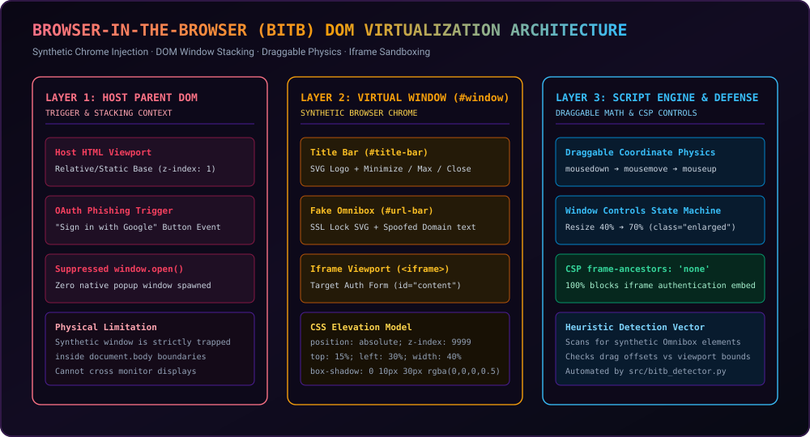
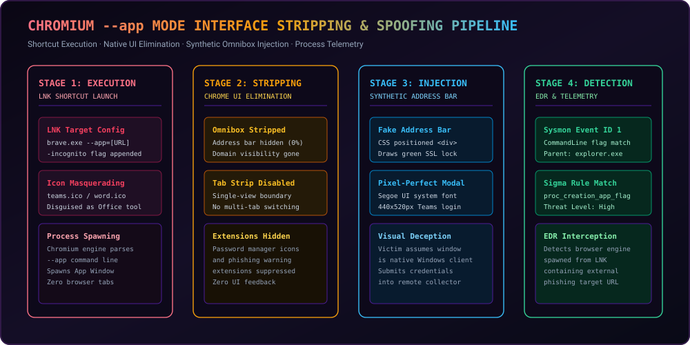
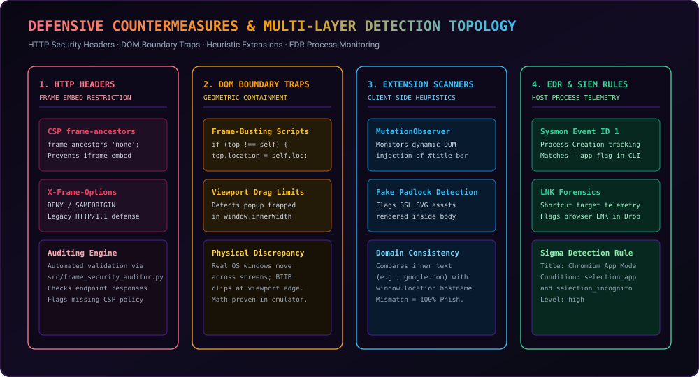

# Browser-in-the-Browser (BITB) محاكاة الـ DOM الافتراضية والمحرك الجنائي

<p align="center">
  <a href="https://github.com/maya-thorne/browser-in-the-browser-virtualization">
    
  </a>
</p>

<p align="center">
  <strong>المحاكاة الافتراضية للـ DOM على جانب العميل • تجريد واجهة Chromium --app • محرك الكشف الإرشادي • بنية الدفاع</strong>
</p>

<p align="center">
  <a href="./en.md">English</a> &bull;
  <a href="./ko.md">한국어</a> &bull;
  <a href="./ja.md">日本語</a> &bull;
  <a href="./zh-CN.md">简体中文</a> &bull;
  <a href="./es.md">Español</a> &bull;
  <a href="./fr.md">Français</a> &bull;
  <a href="./ru.md">Русский</a> &bull;
  <a href="./pt-BR.md">Português</a> &bull;
  <a href="./de.md">Deutsch</a> &bull;
  <a href="./ar.md">العربية</a>
</p>

---

## 📌 نظرة عامة (Executive Overview)

**Browser-in-the-Browser (BITB)** هي تقنية متقدمة لانتحال واجهة المستخدم تقوم بمحاكاة نافذة منبثقة افتراضية لنظام التشغيل داخل نموذج كائن المستند (DOM) لصفحة الويب، متجاوزة الفحص البصري لشريط العناوين.

---

## 🔬 الأوراق البيضاء الأساسية والتوثيق الفني

<details open>
<summary><b>الأوراق البيضاء الأساسية والتوثيق الفني</b></summary>
<br>

<table width="100%">
  <thead>
    <tr>
      <th width="6%" align="center">#</th>
      <th width="30%" align="left">📄 الوثيقة / الورقة البيضاء</th>
      <th width="54%" align="left">🔬 النطاق الأساسي والتغطية الجنائية</th>
      <th width="10%" align="center">📦 التنسيق</th>
    </tr>
  </thead>
  <tbody>
    <tr>
      <td align="center"><strong>1</strong></td>
      <td>
        🔬 <strong><a href="../whitepapers/BITB_DOM_VIRTUALIZATION_AND_CODE_TEARDOWN.md">محاكاة DOM BITB الافتراضية</a></strong><br>
        <code>BITB_DOM_<wbr>VIRTUALIZATION_<wbr>AND_CODE_TEARDOWN.md</code>
      </td>
      <td>
        تفكيك إطار عمل mr.d0x: بنية الـ DOM، وسياق التراكم في CSS (z-index: 9999)، وفيزياء إحداثيات السحب والإفلات، وتضمين نماذج iframe.
      </td>
      <td align="center"><strong>Markdown</strong></td>
    </tr>
    <tr>
      <td align="center"><strong>2</strong></td>
      <td>
        ⚙️ <strong><a href="../whitepapers/CHROMIUM_APP_MODE_INTERFACE_SPOOFING.md">التحليل الجنائي لوضع Chromium --app</a></strong><br>
        <code>CHROMIUM_APP_<wbr>MODE_INTERFACE_<wbr>SPOOFING.md</code>
      </td>
      <td>
        تجريد واجهة المستخدم وتمويه اختصارات LNK: بنية معامل --app، والإخفاء التام لشريط العناوين وعلامات التبويب، وانتحال برامج Teams/Office.
      </td>
      <td align="center"><strong>Markdown</strong></td>
    </tr>
    <tr>
      <td align="center"><strong>3</strong></td>
      <td>
        🛡️ <strong><a href="../whitepapers/DEFENSE_AND_DETECTION_ENGINEERING.md">مصفوفة الدفاع والكشف</a></strong><br>
        <code>DEFENSE_AND_<wbr>DETECTION_<wbr>ENGINEERING.md</code>
      </td>
      <td>
        دفاع مؤسسي متعدد الطبقات من 4 مستويات: سياسة أمان المحتوى frame-ancestors 'none'، وفخاخ جافا سكريبت، وقواعد Sysmon/Sigma.
      </td>
      <td align="center"><strong>Markdown</strong></td>
    </tr>
  </tbody>
</table>
</details>

---

## 🖥️ عرض توضيحي مباشر عبر الطرفية

<p align="center">
  <a href="https://github.com/maya-thorne/browser-in-the-browser-virtualization">
    
  </a>
</p>

---

## 📐 طوبولوجيا النظام ومخططات البنية

<details open>
<summary><b>طوبولوجيا النظام ومخططات البنية</b></summary>
<br>

### 1. التسلسل الهرمي لمحاكاة الـ DOM
<p align="center">
  
</p>

### 2. مسار تنفيذ Chromium --app
<p align="center">
  
</p>

### 3. طوبولوجيا الدفاع متعدد المستويات
<p align="center">
  
</p>
</details>

---

## ⚡ البداية السريعة

<details open>
<summary><b>البداية السريعة</b></summary>
<br>

```bash
# 1. Run static heuristic scanner on target web application
python src/bitb_detector.py --path references/bitb_templates/windows_chrome_dark/index.html

# 2. Run automated HTTP frame security auditor
python src/frame_security_auditor.py --file references/bitb_templates/windows_chrome_dark/index.html

# 3. Execute full unit test suite
python -m unittest discover -s tests -p "test_*.py"
```
</details>

---

## 📜 الترخيص وإشعار البحث

Distributed under the **[Maya Thorne Systems & Security Research License (MT-SRL)](../../LICENSE)**.  
Published strictly for dual-use cybersecurity research, browser architecture analysis, and defensive engineering.
